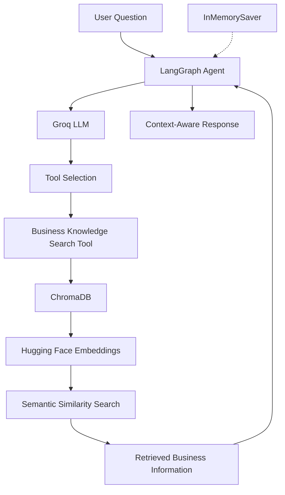

# 🧠 Day 5 – Business Knowledge Agent | RAG + ChromaDB + LangGraph

## 📌 Project Overview

The **Business Knowledge Agent** is an AI-powered business information assistant that retrieves relevant information from a vector database and uses a Large Language Model (LLM) to generate context-aware responses.

The project demonstrates how to build a Retrieval-Augmented Generation (RAG) workflow by combining semantic search, vector embeddings, ChromaDB, AI tool calling, and LangGraph.

Instead of relying entirely on the LLM's pre-trained knowledge, the assistant uses information retrieved from a business knowledge database to answer business-related questions.

The implementation uses a sample retail business, **ABC Store**, to demonstrate business knowledge storage, semantic retrieval, conversational memory, and hallucination-prevention techniques.

## 🎯 Objectives

- Understand the fundamentals of Retrieval-Augmented Generation (RAG).
- Store business information in a vector database.
- Generate text embeddings using Hugging Face Sentence Transformers.
- Perform semantic similarity searches using ChromaDB.
- Convert the retrieval function into an AI-accessible tool.
- Integrate the retrieval tool into a LangGraph agent.
- Implement conversational memory using thread IDs and checkpointers.
- Explore techniques for reducing hallucinations in LLM responses.
- Understand the interaction between vector databases, retrieval tools, and AI agents.

## 🛠️ Technologies Used

| Technology | Purpose |
|---|---|
| Python | Application development |
| Groq API | LLM inference |
| GPT-OSS 120B | Language model |
| LangChain | LLM and tool integration |
| LangGraph | Agent workflow orchestration |
| ChromaDB | Vector database |
| Hugging Face | Text embedding generation |
| Sentence Transformers | Embedding model |
| Google Colab | Development environment |

**Embedding Model:** `sentence-transformers/all-MiniLM-L6-v2`

**LLM:** `openai/gpt-oss-120b`

## 🏪 Business Knowledge Base – ABC Store

A sample retail business located in Hyderabad is used to demonstrate the RAG implementation.

### Business Information

| Category | Stored Information |
|---|---|
| Business Name | ABC Store |
| Location | Hyderabad |
| Business Type | Retail Business |
| Products | Electronics and accessories |
| Services | Product sales and customer support |
| Business History | Started in 2020 |
| Owner | ABC |
| Working Hours | 9 AM – 9 PM |
| Contact | 9876543210 |
| Pricing | Depends on the product |
| Payment Methods | Cash and UPI |
| Customer Support | Available during working hours |
| Delivery | Within the city |
| Special Offers | Seasonal discounts |
| Business Policies | Products can be exchanged within 7 days |

**Note:** ABC Store is sample data used for learning and demonstration purposes.

## 🏗️ System Architecture

The application follows a retrieval-based agent architecture.



### Workflow Explanation

1. The user submits a business-related question.
2. The LangGraph agent receives the question.
3. The LLM determines whether to invoke the business knowledge search tool.
4. The search tool performs semantic retrieval from ChromaDB.
5. Relevant business information is returned to the agent.
6. The LLM uses the retrieved information to formulate a response.
7. The final response is returned to the user.

The LangGraph checkpointer maintains conversation state using thread IDs.

## 📚 Implementation Details

### 1. Business Knowledge Storage in ChromaDB

**Objective:** Store business information as searchable vector embeddings.

Implementation:

- Created a collection of 15 business facts.
- Represented each fact as an individual LangChain Document.
- Added metadata such as fact number and source.
- Generated embeddings using Hugging Face Sentence Transformers.
- Stored the embeddings and documents in ChromaDB.

**Vector Database Configuration:**

- Collection: `business_knowledge`
- Embedding Model: `all-MiniLM-L6-v2`
- Distance Metric: Cosine
- Storage Directory: `./chroma_db`

**Verification:**

The notebook checks the number of stored documents.

Expected result:

```text
Total business facts: 15
PASS: Required business facts are stored.
```

### 2. Semantic Search Tool

**Objective:** Retrieve relevant business information based on natural-language questions.

Created a LangChain tool named:

`search_business_knowledge`

Implementation:

- Accepts a natural-language query.
- Searches ChromaDB using semantic similarity.
- Retrieves the top 3 matching documents.
- Applies a similarity-distance threshold of `0.45`.
- Returns the relevant business information.
- Returns a `NO_RELEVANT_INFORMATION` message when no results satisfy the threshold.

**Example Query:**

```text
What payment methods are accepted?
```

**Retrieved Information:**

```text
Payment methods: Cash and UPI
```

This demonstrates how semantic retrieval can find relevant information without requiring an exact keyword match.

### 3. LangGraph Agent Integration

**Objective:** Integrate the business knowledge search tool into an AI agent.

Implementation:

- Initialized the Groq model using LangChain.
- Bound the search tool to the LLM.
- Created an agent workflow using LangGraph StateGraph.
- Implemented an agent node for model interaction.
- Added a ToolNode to execute the retrieval tool.
- Used `tools_condition` for conditional routing.
- Connected the tool execution back to the agent.
- Compiled the graph with an InMemorySaver checkpointer.

**Agent Workflow:**

```text
User Question
     |
     v
Agent Node
     |
     v
LLM Tool Selection
     |
     v
Search Tool
     |
     v
ChromaDB Retrieval
     |
     v
Retrieved Information
     |
     v
Agent Node
     |
     v
Final Response
```

This implementation demonstrates the Think–Act–Observe workflow of a tool-using AI agent.

### 4. Conversational Memory Using LangGraph

**Objective:** Maintain separate conversation histories for different users.

Implemented conversational memory using:

- LangGraph `MessagesState`
- `InMemorySaver`
- Thread IDs

Each conversation is associated with a unique thread ID.

Example:

```python
response = chat(
    "What products does the business offer?",
    "user_1"
)
```

**Experiments Performed:**

1. Sent a message containing a user's favourite colour.
2. Asked the assistant to recall the information using the same thread ID.
3. Started another conversation using a different thread ID.
4. Checked whether information from the first conversation was accessible in the second.

**Learning Outcome:**

Understood how thread IDs maintain separate conversational states and how checkpointers support conversation continuity.

### 5. Hallucination Prevention

**Objective:** Explore how retrieval-based grounding and system instructions can reduce unsupported business responses.

Added system instructions to guide the assistant to:

- Use the business knowledge search tool for business-related questions.
- Answer using information retrieved from the database.
- Avoid inventing business details.
- Avoid guessing missing information.
- Clearly communicate when information is unavailable.

**Test Questions:**

| Question | Expected Behaviour |
|---|---|
| What is the owner's favourite food? | Should not invent an answer |
| What was the business revenue last year? | Should identify missing information |
| How many employees work in the business? | Should identify missing information |

The notebook demonstrates both successful fallback responses and cases where the model produces unreliable output.

**Important:** These instructions are experimental safeguards, not a guarantee of hallucination-free responses. The stricter rules defined later in the notebook also need to be connected to the constructed agent before they can affect its behaviour.

## 🧪 Testing and Verification

The notebook includes several practical tests to examine the individual components.

| Test | Purpose |
|---|---|
| ChromaDB Storage | Verify that 15 business facts are stored |
| Search Tool | Inspect the retrieval tool description |
| Semantic Search | Retrieve information using natural-language queries |
| Agent Integration | Test the connection between the LLM and retrieval tool |
| Conversation Memory | Examine information retention within a thread |
| Thread Isolation | Test separation between different threads |
| Hallucination Prevention | Test questions about unavailable business information |

### Sample Retrieval Results

**Question 1:**

Where is the business located?

**Retrieved Result:**

```text
Business location: Hyderabad
Business name: ABC Store
```

**Question 2:**

What payment methods are accepted?

**Retrieved Result:**

```text
Payment methods: Cash and UPI
```

**Question 3:**

What are the business working hours?

**Retrieved Result:**

```text
Working hours: 9 AM to 9 PM
```

### Observed Limitations During Testing

The experiments also exposed some issues:

- The product retrieval query did not consistently retrieve the expected product information.
- The integrated agent returned an insufficient-information response even when the underlying business facts were available.
- Some unknown-information queries produced repeated or malformed responses.
- The final stricter system rules were defined after agent construction and were not applied to the existing agent instance.

These results show why retrieval quality, prompt configuration, and end-to-end testing are important when building RAG applications.

## 📂 Project Structure

The notebook generates the following Python modules:

```text
Day-5/
│
├── business_facts.py
│
├── vector_store.py
│
├── search_tool.py
│
├── agent.py
│
├── chroma_db/
│
└── AgenticAi_Day5.ipynb
```

| File | Responsibility |
|---|---|
| `business_facts.py` | Stores the sample business information |
| `vector_store.py` | Generates embeddings and manages ChromaDB storage |
| `search_tool.py` | Implements semantic business information retrieval |
| `agent.py` | Creates the LangGraph agent and conversational interface |
| `chroma_db/` | Stores the local vector database |
| `AgenticAi_Day5.ipynb` | Contains implementation steps and experiments |

## ⚙️ Execution Environment

The notebook is designed for Google Colab.

### 1. Install Dependencies

```bash
pip install -q langchain-groq langchain-chroma langchain-huggingface langgraph sentence-transformers
```

### 2. Configure the Groq API Key

1. Create a Groq API key.
2. Open Google Colab.
3. Navigate to the Secrets section.
4. Add a secret named `GROQ_API_KEY`.
5. Enable notebook access.

### 3. Run the Notebook

1. Open `AgenticAi_Day5.ipynb` in Google Colab.
2. Execute the cells in the correct sequence.
3. Generate the Python modules.
4. Initialize the embedding model and ChromaDB.
5. Initialize the Groq LLM.
6. Build and test the LangGraph agent.

**Environment Note:** The current generated `agent.py` uses Google Colab's `userdata` API for key retrieval. Running it outside Colab requires changing the API-key configuration. The notebook also contains earlier experimental Grok/xAI configuration cells; the final agent module uses Groq.

## 🧠 Key Learning Outcomes

Through this implementation, I explored:

- Retrieval-Augmented Generation (RAG).
- Vector databases and semantic search.
- Text embeddings using Sentence Transformers.
- ChromaDB collection management.
- LangChain Document objects.
- AI tool creation and tool calling.
- LangGraph StateGraph and conditional routing.
- Agent and tool execution workflows.
- Conversation memory and thread isolation.
- Checkpointers using InMemorySaver.
- Grounding LLM responses in retrieved information.
- Hallucination-prevention techniques.
- Testing and debugging RAG-based AI applications.

## ⚠️ Limitations and Future Improvements

The current implementation is a learning prototype. The following improvements would make it more reliable and suitable for real-world applications.

- Improve retrieval relevance and evaluate similarity thresholds.
- Add automated retrieval evaluation using precision and recall.
- Connect the stricter hallucination-prevention rules to the actual agent.
- Add reliable fallback handling for unsupported questions.
- Improve response validation and error handling.
- Replace sample business facts with verified real-world data.
- Implement a proper document ingestion and update pipeline.
- Move API-key configuration to environment variables for portability.
- Replace in-memory conversation storage with persistent storage.
- Add automated unit and integration tests.
- Build a web-based interface for customer interaction.

## 🚀 Conclusion

The Business Knowledge Agent demonstrates the integration of vector databases, semantic search, LLMs, and agent orchestration to build a retrieval-based business assistant.

By combining Hugging Face embeddings, ChromaDB, LangChain tools, Groq, and LangGraph, this project explores how an AI agent can retrieve external knowledge and use it during conversations.

The implementation also highlights an important engineering lesson: **building a RAG pipeline is not just about storing embeddings and retrieving documents; the retrieval results must be relevant, the agent must use them correctly, and the final responses must be tested for reliability.**

This project strengthened my understanding of RAG architecture, vector search, AI tool calling, conversational memory, and the challenges involved in developing reliable AI-powered applications.
